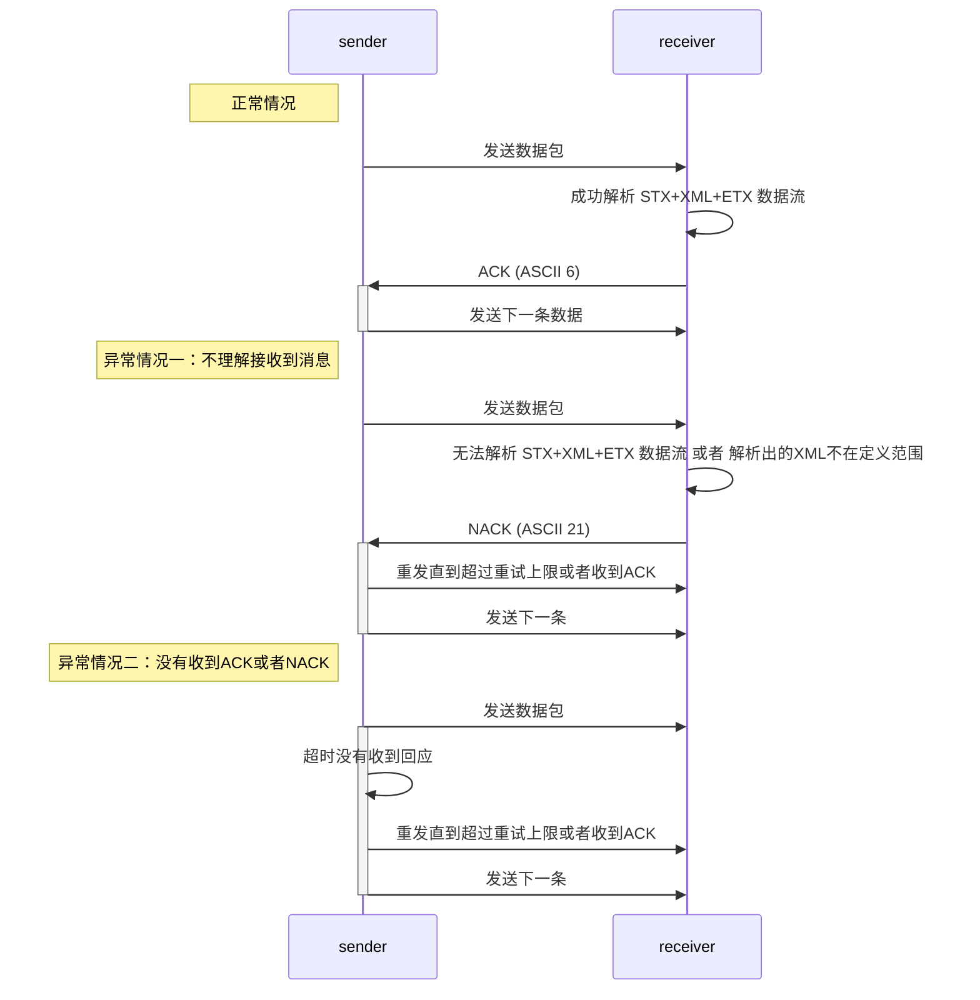
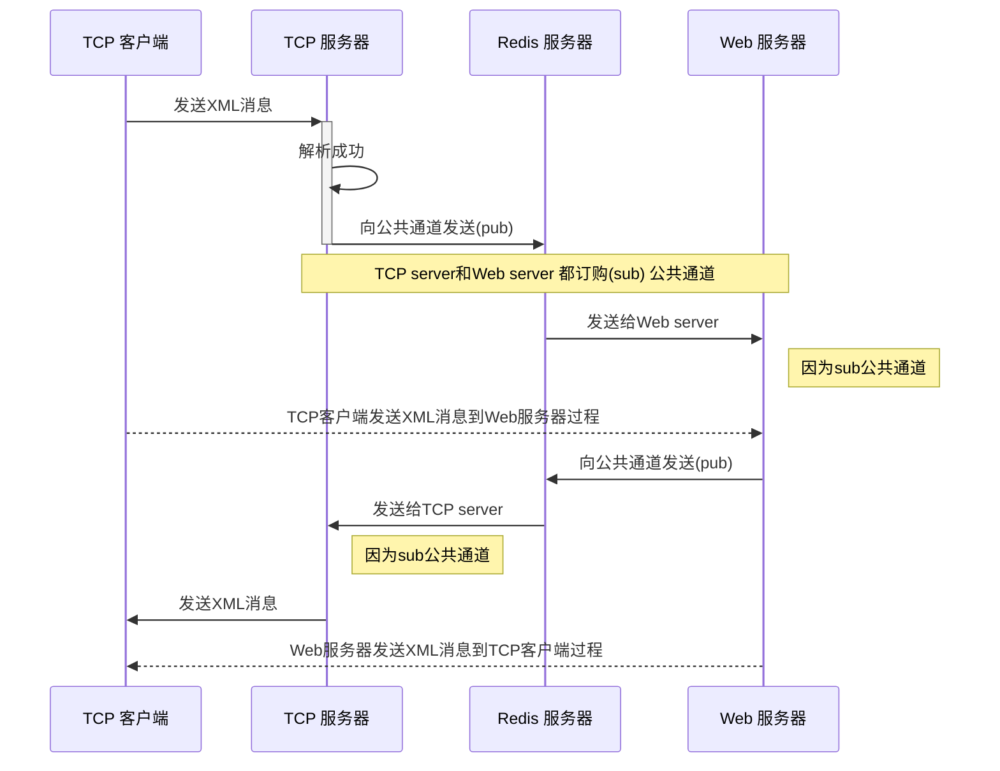

# TCP 服务器/客户端概要设计

## TCP 服务器/客户端实现

根据FCS 接口文档，我们和它通信通过TCP服务来接收和发送XML消息。 我们基于[nodejs 提供系统库 Net](https://nodejs.org/api/net.html) 来实现TCP服务，解析xml 数据包采用开源 [fast-xml-parser](https://github.com/NaturalIntelligence/fast-xml-parser) ，并借鉴目前的websocket 服务器设计，TCP服务器和CM后端交互同样通过 **redis pubsub** 来实现 。

TCP 服务器相当于中间人作用，把FCS发来消息转发给Web服务器，它自己不直接和MySQL数据库交互，不直接把接收消息存入数据库。

CM后端可以只订购一个redis**公关通道**用来接收所有TCP客户端消息，然后通过代码逻辑区分不同客户端消息；也可以为每个TCP客户端订购一个通道，通过它单独接收TCP服务器发来的该客户端消息， 但仍然需要订购一个公共通道用来接收初始消息。 同理， TCP 服务器也可以只订购一个redis公关通道用来接收所有CM后端发来消息，通过代码逻辑区分不同客户端消息；也可以为每个TCP客户端订购单独一个通道接收CM后端发来的该客户端消息。

根据目前需求文档，每家酒店都要部署一套我们系统，那实际还不存在不同客户共用TCP 服务和redis pubsub 服务的情况，所以目前先采用TCP服务器和CM服务器**都只订购一个**redis公关通道方式来实现消息交互。这是和websocket服务器设计不同地方，websocket服务器为每个坐席都单独订购一个通道。

注：FCS 文档描述 In usual cases, **FCS Unicorn would be the client** while the external system would be the host, however, Unicorn also can be configured as the tcp server if required. 所以FCS通常作为TCP的客户端，我们作为TCP服务器，但我们同时也会实现TCP client 

### TCP 服务和 FCS 交互的协议分析

TCP 数据包处理有两个注意点：

1. 在TCP 层面没法标记数据的开始和结束，需要在应用层面来做。常见办法有在应用层标记**数据包长度(length)**，比如http/websocket 采用此方法；或者用**特殊字符**来比较开始结束，FCS采用这种方法(**STX/ETX**对)。对于特殊字符对就可能需要等待几个包，所以进一步分析如下：

2. TCP 数据包理论上限值是64k，但实际的size上限值由最大传输单元MTU决定，经验值通常在 [1400bytes左右](https://stackoverflow.com/questions/2613734/maximum-packet-size-for-a-tcp-connection) ，根据FCS文档列出交互数据示例，都远小于这个值。为了保险起见，也兼顾设计的复杂度，我们对每次接收到数据包的处理算法在下面描述。

我们的TCP服务和FCS 通信根据FCS 接口文档，交互的协议有以下几个实现要求：

1. Each message exchanged between FCS Unicorn and external system will need to be encapsulated as  **STX** (ASCII 2)  + MESSAGE BODY + **ETX** (ASCII 3) .  The MESSAGE BODY is of XML message, the root element defines the record type. 所以每个和 FCS 交互的消息都是 XML 字符串用 STX 和 ETX 作为头尾字符，而且根据下面一条串行处理逻辑，当发完一个XML消息发送需要等待相应才会再发下一个XML消息。一个XML消息通常在一个tcp包里，STX是包头，ETX是包尾，但考虑极端情况，一个XML消息可能被拆成两个甚至多个tcp包，所以接收算法是每收到一个包就判断包尾是否为ETX字符，如果不是认为数据还没发送完，把收到和数据和之前数据合并；如果包尾是ETX认为本次数据发送完成，把之前所有缓存数据合并再进一步判断，如果数据头不是STX就做非法数据处理发送NAK，如果STX就解析XML数据。

2. All messages received by both parties need to be replied with an ACK (ASCII 6) or NAK (ASCII 21). If an ACK is not received within a defined timeout period, the sender will retransmit the message again. This continues until a maximum retry has been reached. The message will be discarded after that and **the next message in the queue will be sent.** 每发送一个消息都要等接受方发来ack ，如果在规定的超时时间内没收到ack 就要重发该消息直到收到ack或者达到最大重试次数。注意协议里说 the next message in the queue will be sent，这就意味着消息是**串行处理**，一条消息处理完（成功收到ack或者达到最大重试次数）才会再处理下一条消息；也意味着一个TCP数据包不可能含两个XML消息；但一个XML消息可能在一个TCP包或跨数个TCP。

3. **NAK** indicates that the external system had received a message, which it does not understand. Upon receiving NAK, FCS Unicorn will **retransmit the last message** till the maximum retry had been reached.  如果收到消息没法解析成事先约定好的XML消息类型，需要回复NAK，如果收到NAK需要重发刚才那条消息直到收到ack或者达到最大重试次数。NAK消息应该是为了容错和以后的扩展，比如因为消息丢包，接收方没法正确解析XML消息，回复NAK，发送方就重发该消息；如果能解析XML消息，但是不是事先约定好的消息类型（就是文档说的不能 **understand**的消息），那回复NAK在目前意义可能不大，因为重发的消息可能还是不能understand. 但对于NAK消息需要有统计，以便以后分析它发生的原因。

4. Data resent after timeout expired if sender do not receive any replies from the receiver. Data will be drop after exceed numbers of retries. 发送消息后需要等待相应，如果**等待响应超时**就重发消息直到收到相应或者达到重发上限。注：极端情况是重发数次后收到NACK （或者NACK重发后没有响应），如果重发次数少于重发上限值，根据NACK处理接着重发直到重发上限值，也就是重发次数对超时和NACK统一计数（做简单处理），不针对他们中任何一种情况单独计数。

   

#### FCS 定义的 ACK/NACK/无响应 交互图




### FCS和我们系统的交互过程

FCS作为TCP客户端通过以下流程实现和我们系统的交互。

TCP服务器和web服务器的交互过程借鉴原来websocket 服务器的实现，通过 redis的 pubsub 和 CM Web 服务器交互。当TCP服务器和web服务器需要向对方发送消息，先把消息`pub` 到redis 服务器事先`sub`的公关通道，然后接收方在`sub`响应事件里处理收到的消息：



redis pubsub方式发送的数据是不保留的，如果sub方没有处理就被丢弃。 Redis 5针对这种问题引入 [stream](https://redis.io/docs/data-types/streams/) 但我们目前还用pubsub，通过 pubsub 发送数据可以是完整的XML数据包，也可以是 XML "**摘要**", 实际的数据存在redis里。当收到sub 通知，接收方再从 redis中读出完整数据，通过这样来保证数据丢失。但是采用这个方法**双方**（TCP服务器和Web服务器）需要约定好处理完数据就要它从redis清除，不然会造成冗余、过时数据。

### 收发消息伪代码示例

根据以上定义到处理逻辑，我们对发送消息和接收消息分别做如下定义。

```
//sendMessage 来自我们Web系统，通过pubsub接收，主要有这些属性
sendMessage { 
  data //具体xml内容
  response //FCS 客户端到响应情况， ACK/NACK/No response
  retry //重试次数,针对NACK和No response
  status //成功发送，即收到ACK 或者失败。失败最终都是因为超过重试上限，但是要记录是因为NACK 还是 No response
}

//每接收一个tcp包的判断示例
if NOT endWith ETX {
   没有以ETX结束表示数据未接收完整，合并缓存数据，返回
}
//接收完整结束，对缓存数据做判断
if NOT beginWith STX return invalid //判断非法数据
//有头有尾, 解析其中XML数据
parseXML(...)

receiveMessage { 主要有这些属性
  isComplete //是否收到 ETX 结束符
  isValid //true: isComplete 情况下，buffer头STX，尾是ETX; 否则设置false，回复NACK
  buffer //目前缓存数据
  data //具体xml内容
}
```

以ETX结尾作为一次收包结束，可能会有这样极端情况：一个被拆分的XML包，ETX结尾的包丢失；发送方没有等到ACK确认，超时再发送一次，这次正确接收。这样再缓存数据里就有两段STX头，考虑这种极端情况就要对多余STX做处理，记录错误，丢弃多余STX头再解析。


### FCS消息定义

我们系统和FCS对接主要用于客房状态同步和计费功能。对接接口大致可以分3部分 ：

1. FCS --> 呼叫中心，主要用于同步客房状态。
2. 呼叫中心 -->FCS，用于对客房客户计费。
3. 语言信箱对接。 

根据FCS定义的消息类型的分析，有几个消息是属于请求和响应对；对于数据同步请求还需要一对开始和结束消息对来包裹需要同步数据，对应数据同步的流程会在实现中进一步细化。

FCS 定义的消息格式有**不严谨**的地方，解析XML需要注意。比如**除了**我们发往FCS的查询 job状态消息 `JobEnquiry`消息和它的相应 `JobEnquiry Respond`，其他**所有**消息都含有**消息唯一ID** `GUID`和消息发送时间 `SysDaTi` ，保活消息`STAY ALIVE` 只有 `GUID`和`SysDati`

GUID 没有明确定义消息格式，但从示例看应该是 **UUID**格式，36个字符，32个字符+ 4个`-`分隔符： [8个字符-4个字符-4个字符-4个字符-12个字符] ，消息发送时间格式除了 **JobEnquiry**，其他都定义为 `yyyy/mm/dd hh:mm:ss`

除了保活消息`STAY ALIVE`   **其他所有消息都带** `PId` Property ID 但它格式不明确。但是 FCS 又定义 `ErrorMessage` 必须含 `GUID`和`SysDaTi`，但`PId`不是必填。`ErrorMessage`是FCS处理我们消息出错时候的回应，具体什么情况FCS发 `ErrorMessage`还需要进一步确认。

`JobEnquiry` 示例如下， 唯一没有 `GUID` 的消息，时间格式和别的消息不同：

```
<JobEnquiry><SysDaTi>13-Nov-2009 15:00:00</SysDaTi><Sender>PBX1</Sender><PId>1</PId><JobID>123</JobID></JobEnquiry>
```

保活消息示例如下，唯一没有 PId的消息

```
<StayAlive >><SysDaTi>2012/8/4 08:11:07</SysDaTi><GUID>E1A35954-41CC-40f7-BDF1- A7B2CE1EE5B6</GUID></StayAlive >
```


#### 由我们系统发往FCS消息目前定义如下

```
ROOM STATUS
MINI BAR CHARGES/ITEMIZED
CALL CHARGES
POINT OF SALES CHARGES
INTERNET CHARGES
VOD/IPTV CHARGES
VOICE MESSAGE STATUS UPDATE
AUTO WAKEUP CALL SET/CANCEL
AUTO WAKEUP CALL RESPONSE 
REQUEST DATABASE SYNCHRONIZATION // DBSwap
EXPRESS CHECKOUT REQUEST
FOLIO REQUEST
TEXT MESSAGE REQUEST
CREATE JOB
UPDATE JOB
SEND ADHOC MESSAGE //SendAdHocMsg
STAY ALIVE
JobEnquiry
```

除了数据库同步请求 `DBSwap` 和 临时消息 `SendAdHocMsg`只带PId ，其他消息都必须带**房间号和分机号**  `Ex ` 和 `Rm` 

##### 数据库同步消息和临时消息 (AdHoc Message)

数据库同步消息示例： `Request Database Synchronization`  The external system will transmit this message when there is a need to synchronize information between the PMS and external system. 数据库同步消息使用详见 FCS 数据库同步响应的描述。

```
<DBSwap><PId>1</PId><Flag>RQ</Flag><SysDaTi>2012/12/15 07:00:17</SysDaTi><GUID>E1A35954- 41CC-40f7-BDF1-A7B2CE1EE5B6</GUID></ DBSwap >
```

`Send Adhoc Message`  临时消息示例：`Rm`不是必备消息，而且没有分机号`Ex`

```
<SendAdHocMsg ><UserName>fcs</UserName><Password>pwd</Password><PId>1</PId><MesgConte nt>This is urgent </MesgContent><DeviceType>MBL</DeviceType><DeviceNo>0122101234</DeviceNo> <MesgType>NM</MesgType><SysDaTi>2012/8/4 08:11:07</SysDaTi><GUID>E1A35954-41CC-40f7- BDF1-A7B2CE1EE5B6</GUID></SendAdHocMsg>
```


##### Job 消息

Job 消息我们系统或许不会用到，不然Job消息定义有一些不严谨地方，需要和FCS进一步确认。

创建Job对  **房间号和分机号**  `Ex ` 和 `Rm` 有单独要求：

1. Either Ex or Rm must exist
2. Either Rm or LocationCode is required

更新Job消息对 **房间号和分机号**  `Ex ` 和 `Rm` 也有单独要求：

1. Either Ex or Rm must exist
2. Either Rm or JobId or JobNo is required. If set to Room, then system will update all the jobs

但给的示例有矛盾地方，根据第二条有 JobId 可以没有 Rm，但是没有Rm 按第一条就必须有Ex, 但是示例没有

```
<UpdateJob>><JobAction>Ack</JobAction><UserName>fcs</UserName><Password>pwd</Password>< PId>1</PId><ItemCode>10100</ItemCode><JobId>123</JobId><SysDaTi>2012/8/4 08:11:07</SysDaTi><GUID>E1A35954-41CC-40f7-BDF1-A7B2CE1EE5B6</GUID></UpdateJob >
```

综合这两个例子，分机号Ex可以不存在而不引入问题。对于job相应消息，FCS还额外定义 `ModifyJob` 的响应，但不清楚对应是哪条消息，因为`UpdateJob`也专门定义响应消息。


#### 由FCS发送我们系统消息目前定义如下

```
CHECK-IN/CHECK-OUT
MESSAGE WAITING
DO NOT DISTURB
AUTO WAKEUP CALL SET/CANCEL ROOM CHANGE
ROOM INFORMATION CHANGE
DID ASSIGN/UNASSIGNED
CHANGE CLASS OF SERVICE
EXPRESS CHECK OUT RESPONSE
FOLIO DETAIL & BALANCE RESPONSE
TEXT MESSAGE
DATABASE SYNCHRONIZATION 
NIGHT AUDIT
CREATE JOB RESPONSE
UPDATE JOB RESPONSE
MODIFY JOB
SEND ADHOC MESSAGE RESPONSE 
STAY ALIVE
ERROR MESSAGE
```

##### 两组ST和ED标识的响应对

数据库同步响应的使用，先用 ST标识数据同步开始，之后是一系列 check in / check out数据包，而且这些包的需要设置`<DBSwap>Yes</DBSwap>` 同步结束后再发送 ED标识同步结束。 A Database Swap Start indicator record will be sent first, followed by series of check in / check out packets with the `<DBSwap>Yes</DBSwap>`. At the end, a Database Swap End record will be sent to the external system

示例如下：

```
<DBSwap><PId>1</PId><Flag>ST</Flag><SysDaTi>2012/12/15 07:00:17</SysDaTi><GUID>E1A35954- 41CC-40f7-BDF1-A7B2CE1EE5B6</GUID></ DBSwap > //同步开发
<DBSwap><PId>1</PId><Flag>ED</Flag><SysDaTi>2012/12/15 07:00:20</SysDaTi><GUID>E1A35954- 41CC-40f7-BDF1-A7B2CE1EE5B6</GUID></ DBSwap > //同步结束
```

夜间审计消息`Night Audit` 是另一对含 开始ST和结束ED的消息，而且不含 **房间号和分机号**  `Ex ` 和 `Rm` 

```
< NightAudit ><PId>1</PId><Flag>ST</Flag><SysDaTi>2012/12/15 07:00:17</SysDaTi><GUID>E1A35954-41CC-40f7-BDF1-A7B2CE1EE5B6</GUID></ NightAudit >
< NightAudit ><PId>1</PId><Flag>ED</Flag><SysDaTi>2012/12/15 07:00:20</SysDaTi><GUID>E1A35954-41CC-40f7-BDF1-A7B2CE1EE5B6</GUID></ NightAudit >
```

但夜间审计具体内容，即在开始ST和结束ED的消息对之间的消息是什么没有示例。

除了这两个消息对 `DBSwap`和`NightAudit` 还有临时消息 `SendAdHocMsg`的响应消息，其他消息都含**房间号和分机号**  `Ex ` 和 `Rm` 

#####  UpdateJob vs ModifyJob

但是job的`update`和`modify`响应定义不清晰：

FCS will transmit `UpdateJob` message back to the sender upon its `<UpdateJob>` request packet, 示例如下

```
<UpdateJob ><PId>1</PId><Rm>1001</Rm><AnsSts>OK</AnsSts><Flag>RP</Flag><JobNo>100100</Jo bNo><SysDaTi>2012/08/04 08:19:00</SysDaTi><GUID>B2C35054-4BCC-A0B9-BDF1- AB02CE1EE47B8</GUID></UpdateJob>
```

`ModifyJob` will send upon received any modify job from host 但文档没有记录 ModifyJob请求消息

```
<ModifyJob><Rm>100</Rm><Ex>8100</Ex><PId>1</PId><JobNo>21001</JobNo><JobDetail>Check in welcome drinks</JobDetail><EscLevel>0</EscLevel><ItemCode>100011</ItemCode><ItemName>Welcome Drink</ItemName><AssignedTo>ABC</AssignedTo>< Deadline>2012/8/4 08:30:00</Deadline><GuestName >Mr.Dolp</GuestName><LocationName>Room</LocationName><Job Status>Pending</JobStatus><ACKStatus>1</ACKStatus><Sender>GSS2</Sender><SysDaTi>2012/8/4 08:11:07</SysDaTi><GUID>E1A35954-41CC-40f7-BDF1-A7B2CE1EE5B6</GUID></ModifyJob>
```

##### Error Message

This message will contain the error message as a result of invalid message being received

ErrorMessage给的两个示例，一个容易理解，`IPTVCharge`少了必填字段 字段`Chg` movie charges

```
<ErrorMessage><AnsSts>MI</AnsSts><Desc>Missing ‘Chg’ element in ‘IPTVCharge’ packet</Desc><SysDaTi>2012/8/4 08:11:07</SysDaTi><GUID>E1A35954-41CC-40f7-BDF1- A7B2CE1EE5B6</GUID></ErrorMessage >
```

但下一个示例对应情况不明确

```
<ErrorMessage><PId>01</PId><AnsSts>NF</AnsSts><Desc>Feature not supported</Desc><SysDaTi>2012/8/4 08:11:07</SysDaTi><GUID>E1A35954-41CC-40f7-BDF1- A7B2CE1EE5B6</GUID></ErrorMessage >
```

NF 标识 Feature not enabled or checkout process not running 但这是对哪些消息响应不明确。

根据Error Message示例，我们在XML解析时候，解析失败我们回应NACK，但是收到 ErrorMessage 要如何回应还需要再细化。


## 部署方案

目前考虑TCP服务器和 WebSocket服务器部署在同一个docker容器里，因为考虑TCP服务器对性能的要求不会太高，而且连同一个Redis服务器，配置一样。但也可以和WebSocket服务器分开部署，暂时没有特别考量。


## 工作量分解

1. TCP消息包解析处理。
   1. 接收消息处理正确 STX/ETX对，解析他们包含的XML包，回复ACK/NACK
   2. 发送消息处理 ACK/NACK，以及无响应重发
   3. Redis pubsub 正确接收和发送XML消息
2. XML 消息解析处理，对于缺少required节点处理，未知节点处理。但要注意 FCS文档只定义了他们的回复消息有 ErrorMessage用来处理他们认为是错误的XML消息，但没有定义我们如果收到错误XML消息是回复 ErrorMessage，还是 NACK，还是别的方式。
3. FCS定义请求相应对的处理，特别是数据同步请求响应`<DBSwap>`和 Job请求响应对，需要多个XML消息的处理。如果我们暂时不用上Job，可以先不处理Job消息。

概要设计会进一步补充，尤其是对请求响应处理。

### 测试方案

用两种方法来模拟TCP客户端测试：

1. 对于单个数据包可以通过简单脚本或者netcat模拟tcp客户端来发送
2. 对于多个XML消息的请求响应对，比如 数据同步请求和响应，需要开发脚本来实现
