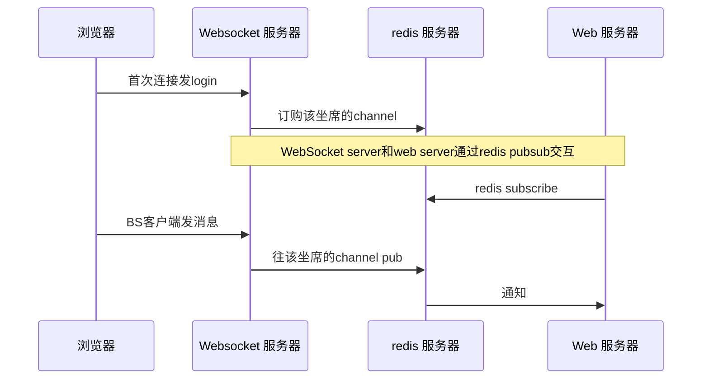
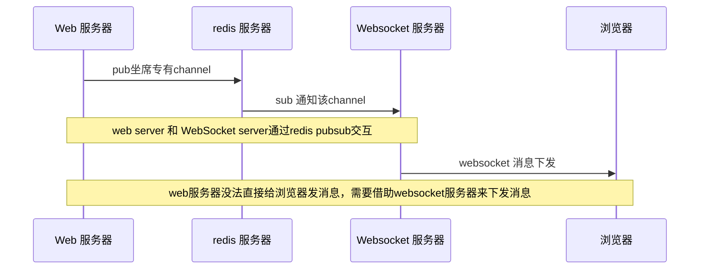

## websocket 服务器概要设计

### websocket 服务器实现

借鉴比较成熟的php websocket服务器实现 [Ratchet](http://socketo.me/) 

由于php本身限制，基于php的web服务器无法同时实现websocket的功能，所以websocket服务器必须是一个独立服务器，它和web服务器没有隶属关系。web服务器需要知道如何和websocket服务器通信。

websocket服务器基于[nodejs](https://nodejs.org/en/)实现，采用成熟的 websocket 开源库 [socket.io](https://socket.io/) 在线客服项目采用过这套解决方法，有成熟经验可以借鉴。

websocket 服务器和web服务器的通信是websocket服务器实现的重点。[借鉴Ratchet建议的通信方式]((http://socketo.me/docs/push)) ,比较 message queue 和 redis pubsub机制，确认[redis pubsub](https://redis.io/topics/pubsub) 完全能满足我们需求，而且实现简单，只要保证 web 服务器和 websocket 服务器访问同一个redis服务器 就能实现两者间通信。

所以浏览器和web服务器通信机制通过以下两个步骤实现：

1. websocket 服务器和 web 服务器通过 redis pubsub机制交互

2.  web服务器和浏览器通过 websocket服务器转发消息。

3. 具体转发消息内容和格式请参见 《BS客户端HLD》

    

### 浏览器和web服务器的交互过程

**浏览器通过 websocket 服务器上传消息给web 服务器：**

客户端通过websocket**首次**连上websocket服务器的时候会给 服务器发`login`消息，带上自己的 `user_id, seid, ccgeid` ，以便服务器记录客户端信息，并订阅改客户端专有的redis 通道。  这是目前浏览器**唯一主动**给服务器发websocket的情况，其他时候浏览器都处在接受消息状态 (除了keepalive消息)

**web 服务器通过 websocket 服务器下发消息给浏览器：**

web服务器下发的具体消息参见《BS客户端HLD》文档，主要是 CR把坐席、呼叫相关消息下发给浏览器。

### 部署方案

1. 通过三个独立git 仓库:  bs，cc-front，websocket 服务器生成dockerfile 
2. 最终发布方式通过一个nginx 发布bs，cc-front内容；转发 websocket 请求；websocket服务器和nginx服务器运行在同一个容器里。对比原来前端部署方法：原来部署只是通过nginx 发布cc-front内容，容器里只有nginx在运行。
3. nginx 配置要点：
   1. bs在子路径`rep`下访问
   2. cc-front 在根路径`/`访问， 根据`/` 规则过滤，该规则还处理 websocket 服务器提供的 web api接口
   3. 对websocket 单独设置过滤规则，因为它们运行在一个容器里，过滤规则只需要设置 `proxy_pass http://127.0.0.1:3000;` 

