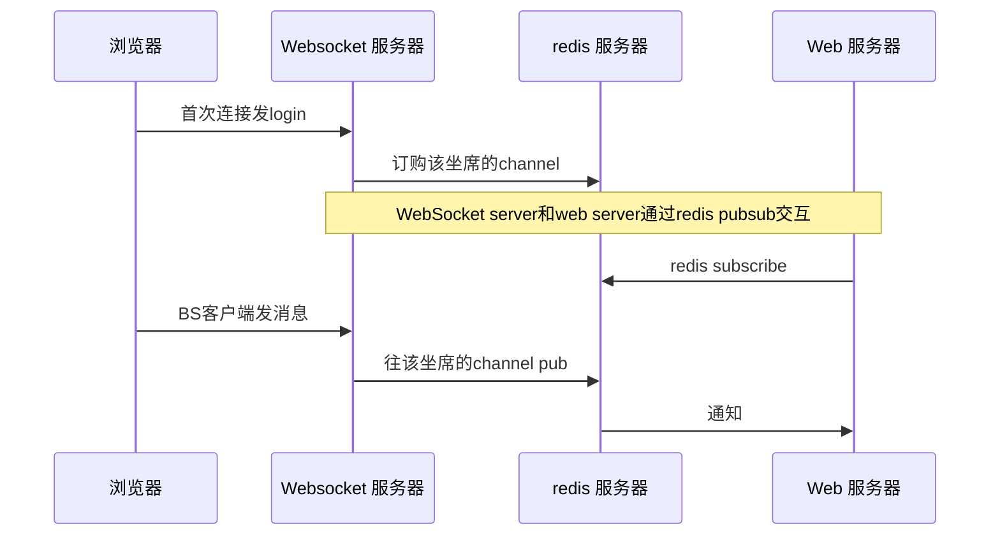
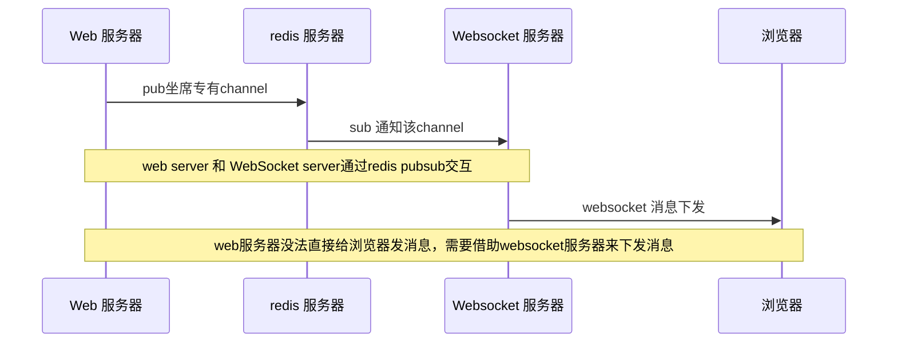

## websocket 服务器概要设计

### websocket 服务器实现

借鉴比较成熟的php websocket服务器实现 [Ratchet](http://socketo.me/) (google "php websocket server" 排名第一的结果)

由于php本身限制，基于php的web服务器无法同时实现websocket的功能，所以websocket服务器必须是一个独立服务器，它和web服务器**没有隶属关系**。web服务器需要知道如何和websocket服务器通信。

websocket服务器基于[nodejs](https://nodejs.org/en/)实现，采用成熟的 websocket 开源库 [socket.io](https://socket.io/) 在线客服项目采用过这套解决方法，有成熟经验可以借鉴。

websocket 服务器和web服务器的通信是websocket服务器实现的重点。[借鉴Ratchet建议的通信方式](http://socketo.me/docs/push) ,比较 message queue, Ratchet使用[ZeroMQ](https://zeromq.org/) 和 redis pubsub机制，确认[redis pubsub](https://redis.io/topics/pubsub) 完全能满足我们需求，而且实现简单，只要保证 web 服务器和 websocket 服务器访问同一个redis服务器 就能实现两者间通信。

所以浏览器和web服务器通信机制通过以下两个步骤实现：

1. websocket 服务器和 web 服务器通过 redis pubsub机制交互

2. web服务器和浏览器通过 websocket服务器转发消息。

注：具体转发消息内容和格式请参见 《BS客户端HLD》；socket.io最终发送数据内容涉及socket.io 的payload格式定义可参见[socket.io文档](https://github.com/socketio/engine.io-protocol#encoding) 

### 浏览器和web服务器的交互过程

**浏览器通过 websocket 服务器上传消息给web 服务器：**

客户端通过websocket**首次**连上websocket服务器的时候会给 服务器发`login`消息，带上自己的 `user_id, seid, ccgeid` ，以便服务器记录客户端信息，并订阅改客户端专有的redis 通道。  这是目前浏览器**唯一主动**给服务器发websocket的情况，其他时候浏览器都处在接受消息状态 (除了keepalive消息)

用坐席的user_id做redis channel 标志，`sub.subscribe(user_id)` 每个坐席有自己redis channel

**web 服务器通过 websocket 服务器下发消息给浏览器：**

web服务器下发的具体消息参见 [BS客户端HLD](http://git.emicloud.com:8888/webcc/bs-front/blob/v5/docs/bsSocket.md)文档，主要是 CR把坐席、呼叫相关消息下发给浏览器。

redis需要存储两组对应关系：

1. 从socket_id 到 user_id的对应。当 websocket的连接状态发生变化（比如断线的时候），查到对应user_id，向redis的这个channel pub 消息，通知服务器。
2. 从user_id 到 socket_id的对应。当收到redis的sub消息(即web服务器发来的消息), 通过channel id即user_id 查到对应socket_id，往对应websocket也就是对应客户端发消息。

### 通过websocket发送的消息

#### login 消息

浏览器ws首次连接向ws服务器发送`login`消息，这是目前ws客户端唯一主动向ws服务器发送的消息，`login`消息传的数据格式发过几次变化：

1.  `user_id, seid, ccgeid`  是最开始版本发送数据，为了记录 `user_id`到`socket_id`的一对一关系。但是实际使用中确认`user_id`是 `seid_ccgeid_uid`形式，所以其实没必要再传 `seid`和`ccgeid`,BS端代码就不再修改，但是ws服务器代码修改了，不再把 `seid`和`ccgeid`存到redis，只存`user_id` 
2. 为了解决同一个账户多出登录问题，引入浏览器指纹 [fingerprint](https://fingerprintjs.com/) 参数，但前端把参数叫 `uniqueId` ,存到redis时候ws服务器依然叫`browserFinger`，这是可选参数，不传就不处理。
3. 回调函数参数`fn` （可选参数），用来通知客户端当前服务器最新版本，BS客户端通过比较这个值和本地保存的值来判断ws服务器是否有新版本。因为ws服务器版本和客户端版本是一起打包的，所以ws服务器有新版本就以为bs客户端也有新版本。

所以 v4版本参数形式是 `socket.on('login', async function (user_id, seid, ccgeid, uniqueId, fn)`

v5 版本增加token认证功能，token必填：

1. 增加`token`参数防止非我们系统ws连接。引入 `locutus` 包用来解析 web服务器 php代码序列化redis的token值，读取redis中`cc-cm:user:tokens:seat:${uid}`和浏览器传入的token作比较，相同才做进一步处理。

2. 为了处理微信客户端传的`token`值，再增加 client参数，只接受 `client.bs`或  `client.wechat`

因为传入参数较多，v5使用 es6 解构复制方法，`socket.on('login', async function ({ user_id, seid, ccgeid, token, uniqueId ='none', client = 'client.bs' } fn)`

另：v5版本同时能处理v4和v5的客户端。   

#### PC客户端和BS浏览器同步消息

1. 坐席状态

2. 呼叫过程消息

#### Web 服务器主动向浏览器下发消息

1. 班长实时监控功能，服务器向浏览器下发坐席状态变化消息。如果没有websocket，只能通过页面不停轮询，效率低下。

2. 坐席、班长登录后，权限发生变化，服务器通知他们重新获取新的数据。

3. 下发消息的方法  `emit('cr_msg',message,ack)` ，下发 message 在浏览器端处理方法 `socketClient.onMessage(({ op_code, ...restData })` 即把消息拆解成 `op_code`和对应数据

4. op_code和对应数据会根据新功能开发而增加和调整，请参见BS相应文档。

   

### 部署方案

1. 通过三个独立git 仓库:  bs，cc-front，websocket 服务器生成dockerfile 
2. 最终发布方式通过一个nginx 发布bs，cc-front内容；转发 websocket 请求；websocket服务器和nginx服务器运行在同一个容器里。对比原来前端部署方法：原来部署只是通过nginx 发布cc-front内容，容器里只有nginx在运行。
3. nginx 配置要点：
   1. bs在子路径`rep`下访问
   2. cc-front 在根路径`/`访问， 根据`/` 规则过滤，该规则还处理 websocket 服务器提供的 web api接口
   3. 对websocket 单独设置过滤规则，因为它们运行在一个容器里，过滤规则只需要设置 `proxy_pass http://127.0.0.1:3000;` 

