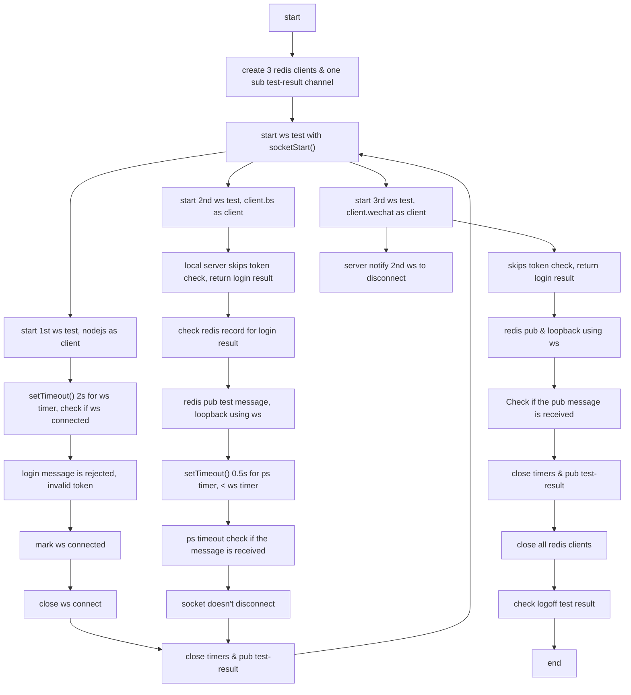

## 测试脚本流程

`npm test` 流程

[Flowchart or Sequence diagram to describe a process?](https://stackoverflow.com/questions/71658379/flowchart-or-sequence-diagram-to-describe-a-process)

注：老版本`gitlab` 的`mermaid` 库 不能解析 `flowchart` 关键字，所以改成 `graph TD`



`socketConnectBug.ts` 的原因

[Global variables in asynchronous code (socket.io) show an error in an unexpected way](https://stackoverflow.com/questions/71852823/global-variables-in-asynchronous-code-socket-io-show-an-error-in-an-unexpected)


## 更新记录

### 为了测试 [RFC] Lite javascript client 

为了测试 [[RFC] Lite javascript client](https://github.com/socketio/socket.io/discussions/4393) 直接引入它的代码，发现不行，因为它用 ES modules 没法和 CJS 混用。

而且昨天为此被搞晕了：

```
error TS7016: Could not find a declaration file for module 'socket.io-client'
Try `npm i --save-dev @types/socket.io-client`

我代码做的改动就是把 
const { Manager,Socket } = require('socket.io-client') 改成
import { Manager,Socket } from 'socket.io-client' 就报了这个错，而且 'socket.io-client' 是用TS写的，不应该有这个错才对，我还以为是tsconfig.json 哪里设置不对造成，找了半天还真的 `npm i --save-dev @types/socket.io-client`
```

最后才意识到我用包有问题

```
-    "socket.io-client": "^2.5.0",
+    "socket.io-client": "^4.6.1",
```


### mjs 

放弃在ts测试，该原来写的`socketConnect.js`，还是碰到类似错，改后缀名为mjs 终于跑成功

```
(node:41553) Warning: To load an ES module, set "type": "module" in the package.json or use the .mjs extension.
(Use `node --trace-warnings ...` to show where the warning was created)
/Users/qiulang/Projects/call-center/ws_redis/src/test/js/socketConnect.js:2
import  io  from 'socket.io-client'
^^^^^^

SyntaxError: Cannot use import statement outside a module
```


